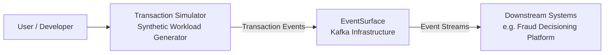
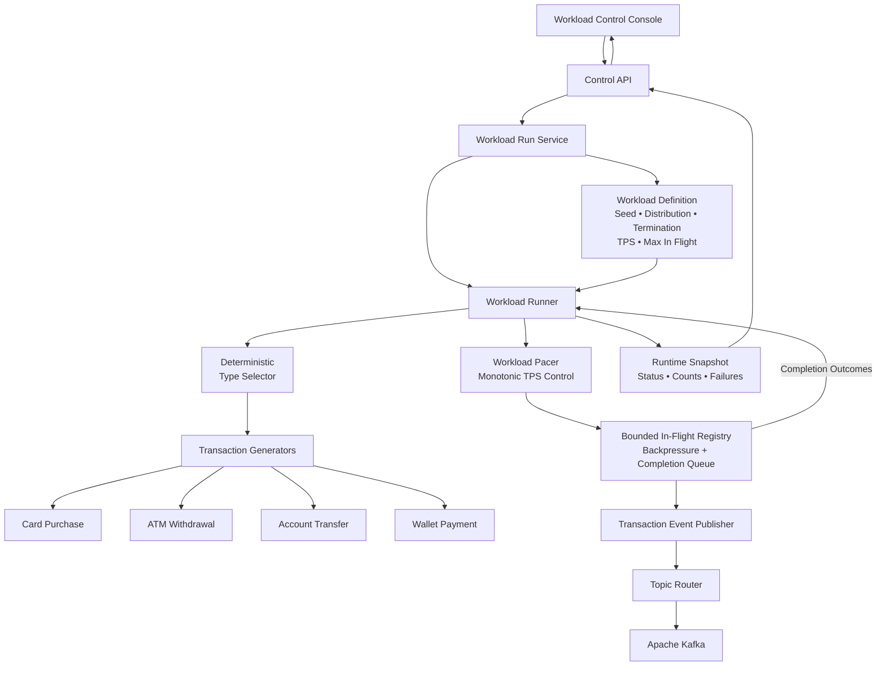
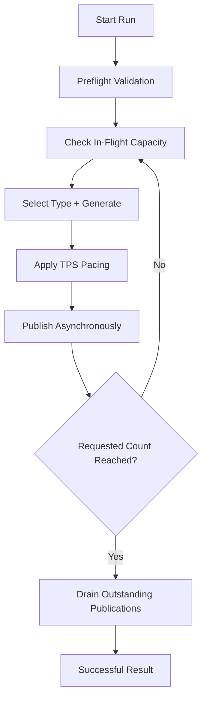
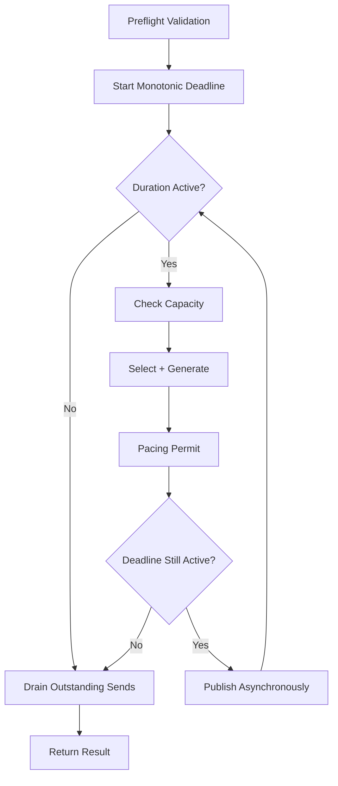
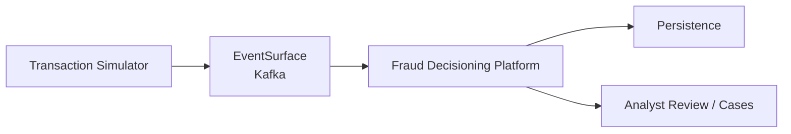

<div align="center">

# Transaction Simulator

### Deterministic Financial Transaction & Workload Simulator

A reusable Spring Boot workload generator for producing realistic, reproducible financial transaction streams into Apache Kafka.

<p>
  
  
  
  
</p>

</div>

---

## Overview

**Transaction Simulator** is a deterministic synthetic transaction and workload generation platform designed for testing event-driven financial systems.

It produces controlled streams of synthetic financial transactions while providing reproducible generation, configurable transaction mixes, workload pacing, count- and duration-based execution, and bounded asynchronous Kafka publication.

The project is designed as a reusable test utility rather than a fraud-decisioning system.

Its responsibility ends at:

```text
Generate
   ↓
Control workload
   ↓
Publish transaction events
   ↓
Observe execution
```

Downstream systems remain responsible for interpreting those transactions and applying business logic.

---

## Key Features

| Area | Capability |
|---|---|
| Transaction generation | Card purchases, ATM withdrawals, account transfers and wallet payments |
| Deterministic generation | Same seed and sequence produce the same synthetic transaction |
| Event contracts | Versioned transaction event envelope |
| Workload metadata | Workload ID, run ID, seed, sequence and generator metadata |
| Mixed workloads | Weighted deterministic transaction-type selection |
| Count execution | Generate an exact number of transactions |
| Duration execution | Run workloads for a configured duration |
| TPS pacing | Configurable maximum publication rate |
| Backpressure | Bounded asynchronous Kafka publications |
| Kafka routing | Transaction type mapped to configurable topics |
| Failure handling | Partial acknowledgement accounting and explicit failure propagation |
| Runtime visibility | Run state, counts and basic execution information |
| Control console | Lightweight workload start/stop/status interface |
| Testing | Deterministic fixtures, fake monotonic time and controllable futures |

---

# Architecture

## System Context



### Responsibility Boundary

```text
Transaction Simulator
├── Generate synthetic transactions
├── Reproduce deterministic workloads
├── Control transaction mix
├── Control TPS
├── Control count / duration
├── Apply publication backpressure
└── Publish events

EventSurface
├── Kafka broker infrastructure
├── Topic provisioning
├── Listener configuration
└── Shared event transport

Downstream Systems
├── Consume transaction events
├── Maintain business state
├── Apply rules
├── Calculate risk
├── Make decisions
└── Persist domain outcomes
```

The Transaction Simulator intentionally contains **no fraud rules, risk scoring, decisioning, analyst review or case-management logic**.

---

# Internal Architecture



---

## Design Principles

### Deterministic generation

Transaction generation depends on deterministic inputs such as:

```text
seed
+
global sequence
+
transaction generator namespace
```

The same deterministic inputs produce the same synthetic transaction.

---

### Single-threaded generation

Transaction selection and generation remain ordered on the workload runner.

```text
sequence 0
sequence 1
sequence 2
sequence 3
...
```

The simulator does not allocate sequences concurrently across generator threads.

---

### Asynchronous publication

Kafka sends may remain outstanding while subsequent transactions are generated and published.

Publication order remains sequential:

```text
0 → 1 → 2 → 3
```

Acknowledgement order may differ:

```text
2 → 0 → 3 → 1
```

---

### Bounded backpressure

The application limits the number of outstanding Kafka publications.

This prevents:

```text
unbounded transaction generation
        ↓
unbounded outstanding futures
        ↓
memory pressure
```

Instead:

```text
generate
   ↓
publish
   ↓
max in-flight reached?
   │
   ├── no  → continue
   │
   └── yes → wait for any completion
```

---

# Supported Transaction Types

The simulator currently supports four financial transaction families.

| Transaction Type | Description |
|---|---|
| `CARD_PURCHASE` | Card-based merchant purchase |
| `ATM_WITHDRAWAL` | Cash withdrawal through an ATM |
| `ACCOUNT_TRANSFER` | Bank-account transfer |
| `WALLET_PAYMENT` | Consumer-to-merchant wallet payment |

---

## Card Purchase

Typical characteristics include:

```text
Channels
├── POS
├── CONTACTLESS
└── ECOMMERCE

Instrument
└── CARD
```

Card transaction details may include:

```text
merchant category code
card-present indicator
entry mode
terminal reference
```

---

## ATM Withdrawal

Typical structure:

```text
CUSTOMER
   │
   ▼
CARD
   │
   ▼
ATM
```

ATM-specific details may include:

```text
ATM reference
operator reference
terminal country
```

---

## Account Transfer

Typical structure:

```text
CUSTOMER
   │
BANK ACCOUNT
   │
   ▼
BENEFICIARY
```

Supported synthetic network categories include examples such as:

```text
INTERNAL
ACH
WIRE
INSTANT
RTGS
NEFT
IMPS
UPI
```

---

## Wallet Payment

Current wallet generation models consumer-to-merchant payments.

```text
CUSTOMER
   │
WALLET
   │
   ▼
MERCHANT
```

---

# Event Contract

Transactions are published using a versioned event envelope.

Conceptually:

```text
TransactionSubmittedEvent
├── eventId
├── eventType
├── schemaVersion
├── source
├── correlationId
├── generatedAt
├── workloadMetadata
└── transaction
```

---

## Workload Metadata

Each event includes workload-generation metadata:

```text
workloadId
runId
seed
sequenceNumber
scenarioCode
generatorInstanceId
```

This allows generated events to be traced back to the workload execution that produced them.

---

## Transaction Structure

The common transaction model includes:

```text
transactionId
occurredAt
type
channel
direction
money
source
destination
paymentInstrument
device
location
transactionDetails
```

Money values use `BigDecimal`.

Timestamps use `Instant`.

Synthetic references are used instead of real financial identifiers.

The simulator does not require:

```text
real PAN
CVV
PIN
real customer PII
```

---

# Kafka Publication

Kafka is currently the primary event transport.

The record key is:

```text
transactionId
```

Events are serialized as JSON.

Spring Kafka type metadata headers are intentionally disabled.

---

## Kafka Headers

Each publication includes headers equivalent to:

```text
event-id
correlation-id
schema-version
transaction-type
workload-run-id
```

---

# Topic Routing

Each transaction type is routed independently.

Example public topic namespace:

| Transaction Type | Topic |
|---|---|
| `CARD_PURCHASE` | `transaction-simulator.transactions.card.v1` |
| `ATM_WITHDRAWAL` | `transaction-simulator.transactions.atm.v1` |
| `ACCOUNT_TRANSFER` | `transaction-simulator.transactions.bank-transfer.v1` |
| `WALLET_PAYMENT` | `transaction-simulator.transactions.wallet.v1` |

Topic names are configurable.

The simulator does not create Kafka topics automatically.

Topic infrastructure is expected to be provisioned by the Kafka platform/environment.

---

# Deterministic Generation

One of the primary design goals is reproducibility.

For the same:

```text
seed
sequence
transaction type
generator namespace
```

the simulator produces the same synthetic transaction.

For example:

```text
seed = 42
sequence = 7
type = CARD_PURCHASE
```

will reproduce the same deterministic transaction when executed again using the same generation rules.

---

## Deterministic Transaction Selection

Mixed workloads use deterministic weighted transaction selection.

Example:

```yaml
distribution:
  CARD_PURCHASE: 5
  ATM_WITHDRAWAL: 2
  ACCOUNT_TRANSFER: 2
  WALLET_PAYMENT: 1
```

These values represent **relative weights**, not quotas.

Therefore:

```text
5 : 2 : 2 : 1
```

is equivalent to:

```text
50 : 20 : 20 : 10
```

A finite workload is not guaranteed to contain the exact percentage split.

However, for the same seed and workload definition, the selected sequence is reproducible.

---

# Workload Execution

The simulator supports two termination modes.

```text
Workload
   │
   ├── COUNT
   │
   └── DURATION
```

---

# Count-Based Workloads

Count mode generates an exact number of publication attempts.

Example:

```yaml
termination-mode: COUNT
transaction-count: 1000
```

The global sequence range is:

```text
0
1
2
...
999
```

A successful count run completes only after all requested publications have been acknowledged.

---

## Count Flow



---

# Duration-Based Workloads

Duration mode runs for a configured time period.

Example:

```yaml
termination-mode: DURATION
duration: 30s
```

Duration uses monotonic elapsed time.

The execution window is:

```text
[start, start + duration)
```

A new publication may begin only while:

```text
elapsed < duration
```

At:

```text
elapsed == duration
```

new publication is no longer permitted.

---

## Duration Example

For:

```text
duration = 2 seconds
TPS = 2
```

ideal publication permits may occur around:

```text
0.0s
0.5s
1.0s
1.5s
```

but not at:

```text
2.0s
```

because the execution interval is half-open.

---

## Duration Flow



Already-issued Kafka sends are allowed to complete after the duration expires.

Duration limits **new publication admission**, not final acknowledgement completion.

---

# TPS Pacing

The simulator supports configurable publication pacing.

Example:

```yaml
pacing:
  enabled: true
  transactions-per-second: 20
```

For:

```text
20 TPS
```

the target interval is approximately:

```text
50 ms
```

between publication permits.

---

## Monotonic Timing

Pacing does not use wall-clock timestamps.

It uses monotonic elapsed time to avoid issues caused by clock adjustment.

---

## No Catch-Up Bursts

Suppose:

```text
target interval = 500 ms
```

but processing delays a publication by 900 ms.

The simulator does not immediately emit multiple transactions to catch up.

Instead:

```text
late publication
       ↓
actual permit becomes new baseline
       ↓
next publication waits normally
```

This prevents burst behavior after temporary delays.

---

# Bounded In-Flight Publication

The application supports a configurable maximum number of outstanding publication futures.

Example:

```yaml
max-in-flight-publications: 4
```

With:

```text
max-in-flight = 4
```

the runtime may behave like:

```text
publish sequence 0
publish sequence 1
publish sequence 2
publish sequence 3

capacity reached

wait for any acknowledgement

sequence 2 completes

one slot becomes available

publish sequence 4
```

The runner does not need to wait specifically for sequence `0`.

---

## Why This Matters

Without bounded publication:

```text
fast generator
     ↓
slow Kafka
     ↓
growing outstanding work
     ↓
memory pressure
```

With application-level backpressure:

```text
fast generator
     ↓
bounded in-flight limit
     ↓
wait for capacity
     ↓
controlled memory usage
```

---

# Sequence Semantics

There is one global zero-based workload sequence.

```text
0, 1, 2, 3, ...
```

The runner owns sequence allocation.

Acknowledgement timing does not determine the next sequence number.

---

## Publication Order vs Acknowledgement Order

Publication attempts remain ordered:

```text
0
1
2
3
```

Acknowledgements may arrive:

```text
2
0
3
1
```

This does not affect deterministic transaction content.

---

# Failure Semantics

The simulator deliberately preserves partial execution information.

If a publication failure is observed:

```text
stop admitting new publications
          ↓
allow already-issued sends to resolve
          ↓
count successful acknowledgements
          ↓
preserve failure context
          ↓
return/throw failure
```

The application does not automatically perform:

```text
retry
rollback
Kafka transaction recovery
exactly-once workflow recovery
```

---

## Example

Suppose:

```text
sequence 0 → success
sequence 1 → failure
sequence 2 → success
```

if all three had already been published before the failure was observed.

The successful acknowledgement set is therefore:

```text
0, 2
```

while the publication-attempt sequence remains contiguous:

```text
0, 1, 2
```

---

# Example Configuration

## Count Workload

```yaml
transaction-simulator:

  kafka:
    topics:
      CARD_PURCHASE: transaction-simulator.transactions.card.v1
      ATM_WITHDRAWAL: transaction-simulator.transactions.atm.v1
      ACCOUNT_TRANSFER: transaction-simulator.transactions.bank-transfer.v1
      WALLET_PAYMENT: transaction-simulator.transactions.wallet.v1

  workload:

    enabled: true

    termination-mode: COUNT

    transaction-count: 1000

    seed: 42

    max-in-flight-publications: 4

    distribution:
      CARD_PURCHASE: 5
      ATM_WITHDRAWAL: 2
      ACCOUNT_TRANSFER: 2
      WALLET_PAYMENT: 1

    pacing:
      enabled: true
      transactions-per-second: 20
```

---

## Duration Workload

```yaml
transaction-simulator:

  workload:

    enabled: true

    termination-mode: DURATION

    duration: 30s

    seed: 42

    max-in-flight-publications: 4

    distribution:
      CARD_PURCHASE: 5
      ATM_WITHDRAWAL: 2
      ACCOUNT_TRANSFER: 2
      WALLET_PAYMENT: 1

    pacing:
      enabled: true
      transactions-per-second: 20
```

Typical Spring Boot duration values include:

```text
500ms
30s
2m
```

---

# Workload Control Console

The project includes a lightweight control interface intended for local development and demonstrations.

The goal is deliberately modest.

It is not intended to become a full frontend platform.

---

## Workload Controls

The console exposes controls such as:

```text
Termination Mode
├── COUNT
└── DURATION

Transaction Count / Duration

Seed

Transactions Per Second

Maximum In-Flight Publications

Transaction Mix
├── Card Purchase
├── ATM Withdrawal
├── Account Transfer
└── Wallet Payment

Start Workload

Stop Workload
```

---

## Runtime Status

The console can display:

```text
Status

Run ID

Elapsed Time

Published Count

Acknowledged Count

In-Flight Count

Failure Count

Average TPS

Acknowledgements by Transaction Type
```

---

## Example Console

```text
┌──────────────────────────────────────────────┐
│           Transaction Simulator             │
├──────────────────────────────────────────────┤
│                                              │
│ Termination                                  │
│                                              │
│ Mode             [ Duration ▼ ]              │
│ Duration         [ 30s       ]               │
│                                              │
│ Workload                                     │
│                                              │
│ Seed             [ 42        ]               │
│ TPS              [ 20        ]               │
│ Max In Flight    [ 4         ]               │
│                                              │
│ Transaction Mix                              │
│                                              │
│ Card Purchase       [ 50 ]                   │
│ ATM Withdrawal      [ 20 ]                   │
│ Account Transfer    [ 20 ]                   │
│ Wallet Payment      [ 10 ]                   │
│                                              │
│          [ Start Workload ]                  │
│          [ Stop Workload  ]                  │
│                                              │
├──────────────────────────────────────────────┤
│ Current Run                                  │
│                                              │
│ Status             RUNNING                   │
│ Acknowledged       359                       │
│ In Flight          3                         │
│ Failed             0                         │
│ Average TPS        19.5                      │
│                                              │
└──────────────────────────────────────────────┘
```

The control console is intentionally designed without requiring:

```text
React
Angular
Node.js
database-backed run history
authentication
distributed workload coordination
```

A small Spring Boot-served frontend is sufficient for the current scope.

---

# Running Locally

## Prerequisites

Install:

```text
Java 25
Docker Desktop / Docker Compose
Git
```

The project includes the Maven Wrapper, so a separate Maven installation is not required.

---

# Kafka Environment

The simulator expects Kafka to be available through the shared EventSurface environment.

For local host applications:

```text
localhost:9092
```

For Docker-network clients:

```text
broker:19092
```

Kafka topic auto-creation is intentionally disabled.

Topics should be provisioned explicitly before running workloads.

---

# Run Tests

## Windows

```powershell
.\mvnw.cmd test
```

## macOS / Linux

```bash
./mvnw test
```

Expected result:

```text
BUILD SUCCESS
```

---

# Run the Application

## Windows

```powershell
.\mvnw.cmd spring-boot:run
```

## macOS / Linux

```bash
./mvnw spring-boot:run
```

Configuration may also be overridden using Spring Boot program arguments.

Example:

```text
--transaction-simulator.workload.enabled=true
--transaction-simulator.workload.termination-mode=DURATION
--transaction-simulator.workload.duration=30s
--transaction-simulator.workload.pacing.enabled=true
--transaction-simulator.workload.pacing.transactions-per-second=20
```

---

# Testing Strategy

The project uses deterministic and controlled tests wherever timing or concurrency is involved.

---

## Generator Tests

Tests verify:

```text
deterministic transaction IDs
deterministic transaction content
valid transaction invariants
stable golden fixtures
correct type-specific structure
```

---

## Workload Selection Tests

Tests verify:

```text
same seed + sequence → same transaction type

global zero-based sequence

normalized relative weights

missing generator validation

missing topic route validation
```

---

## Pacing Tests

Tests use fake monotonic time rather than real sleeps.

Coverage includes:

```text
first transaction without artificial delay

minimum publication spacing

early wake-up

oversleep

no catch-up burst
```

---

## Duration Tests

Coverage includes:

```text
half-open execution window

exact boundary rejection

generation crossing deadline

pacing crossing deadline

late Kafka acknowledgement

zero-event duration success
```

---

## Backpressure Tests

Controllable `CompletableFuture` instances are used to verify:

```text
configured in-flight limit

capacity blocking

out-of-order completion

completion-driven slot release

failure draining

partial acknowledgement accounting

interruption behavior
```

Unit tests do not depend on arbitrary real-time sleeps to prove concurrency correctness.

---

# Technology Stack

| Technology | Purpose |
|---|---|
| Java 25 | Core application |
| Spring Boot 4.1.x | Runtime and configuration |
| Spring Kafka | Kafka producer integration |
| Apache Kafka | Event streaming |
| Jackson | JSON serialization |
| Jakarta Validation | Domain/configuration validation |
| JUnit | Automated tests |
| Maven Wrapper | Reproducible builds |
| Docker Compose | Local Kafka environment |

---

# Architectural Decisions

Significant engineering decisions are recorded using ADRs.

Topics include:

```text
deterministic transaction generation

generic Kafka topic routing

deterministic workload selection

TPS pacing

COUNT vs DURATION termination

bounded asynchronous publication

backpressure and completion handling
```

The ADRs document not only the chosen design but also the reasoning behind it.

---

# Project Scope

Transaction Simulator is intentionally focused.

## Included

```text
synthetic financial transactions

deterministic generation

mixed workload generation

count execution

duration execution

TPS pacing

bounded asynchronous publication

Kafka output

basic workload runtime visibility

lightweight workload control
```

---

## Not Included

The simulator intentionally does not attempt to become:

```text
a fraud decision engine

a customer risk system

a case-management platform

a Kafka administration product

a general-purpose distributed load-testing framework

a production financial-data generator
```

Additional simulation behavior should be introduced only when required by a concrete downstream test case.

---

# Related Architecture

The intended ecosystem is:



---

## Transaction Simulator

Responsible for:

```text
synthetic traffic
deterministic workloads
rate control
publication
```

---

## EventSurface

Responsible for:

```text
Kafka infrastructure
broker configuration
topic provisioning
event transport
```

---

## Downstream Fraud Platform

Responsible for:

```text
transaction ingestion
idempotency
rules
risk calculation
decisioning
persistence
analyst review
case management
audit
```

---

# Why This Project Exists

Testing event-driven systems is difficult when input data is:

```text
manually created
inconsistent
non-reproducible
too small
tightly coupled to the system under test
```

Transaction Simulator provides a reproducible workload source capable of exercising a real Kafka event path while maintaining deterministic transaction generation.

It can therefore support:

```text
integration testing

stream-processing development

rule validation

performance experiments

failure testing

portfolio demonstrations
```

without embedding downstream business logic into the simulator itself.

---

# Engineering Goals

The project demonstrates practical implementation of:

```text
event-driven architecture

deterministic simulation

Kafka producers

asynchronous programming

backpressure

rate limiting

monotonic timing

workload orchestration

failure handling

configuration-driven behavior

testing concurrent workflows

architectural decision records
```

---

<div align="center">

### Transaction Simulator

**Deterministic traffic. Controlled workloads. Reproducible experiments.**

</div>
